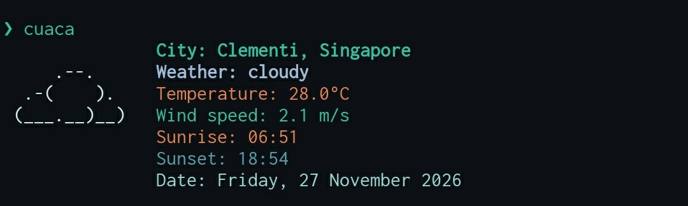

# Cuaca



Cuaca's idea, structure and design is based off [Wttr.in](script/wttr.in) but written in Rust instead of shell script.
The original script had tables that didn't fit on small screens.

## Installation

### Pre-built binaries (GitHub Releases):

1. Download the `.tar.gz` archive for your platform from the [Releases](https://github.com/ddCeka/cuaca/releases) page:
   - Linux (`x86_64`): `cuaca-linux-x86_64.tar.gz`
   - macOS Apple Silicon (`aarch64`): `cuaca-macos-aarch64.tar.gz`
   - macOS Intel (`x86_64`): `cuaca-macos-x86_64.tar.gz`
   - Windows (`x86_64`): `cuaca-windows-x86_64.tar.gz`

2. Extract the binary and place it in a directory in your `PATH`:
   ```sh
   tar -xzf cuaca-<platform>.tar.gz
   ```

### From source:

> **Prerequisites:** Requires **Rust 1.85.0 or newer** (Rust 2024 edition).
>
> **Termux (Android / Bionic) support:** `cuaca` uses `rustls` with the `ring` crypto provider instead of `aws-lc-rs`, so it compiles cleanly on Termux without requiring `cmake` or glibc headers (`pkg install rust`).

1. Clone the repository:

   ```sh
   git clone https://github.com/ddCeka/cuaca.git
   cd cuaca
   ```

2. Build the project using Cargo:
   ```sh
   cargo build --release
   ```

## Usage

```sh
cuaca [OPTIONS]
```

- `-h`, `--help`: Print usage instructions, the active `cuaca.toml` path, and a summary of configuration options.
- `-V`, `--version`: Print version information.

## Configuration

The application reads its configuration file from your system's standard config directory:

- **Linux:** `~/.config/cuaca/cuaca.toml`
- **macOS:** `~/Library/Application Support/cuaca/cuaca.toml`
- **Windows:** `%APPDATA%\cuaca\cuaca.toml`

If the configuration file does not exist, a default one will be created automatically. If an existing configuration file is missing any options, `cuaca` automatically fills in the missing fields with default values and updates the file.

### General Options

- `api_key`: Your OpenWeatherMap API key.
- `city`: The city for which to fetch weather data (e.g., `"London, GB"` or `"New York"`).
- `units`: Units for temperature and wind speed (`"metric"` or `"imperial"`).
- `timeplus`: Hours to add to the UTC timezone (adjusts sunrise, sunset, and displayed date). You can find your timezone offset at https://www.timeanddate.com/.
- `timeminus`: Hours to subtract from the UTC timezone (adjusts sunrise, sunset, and displayed date).
- `showcityname`: Whether to display the city name (`true` or `false`).
- `showdate`: Whether to display the current date (`true` or `false`).
- `timeformat`: Time format for sunrise and sunset times (`"24"` or `"12"`).
- `use_colors`: Enables or disables custom ANSI hex colors (`true` or `false`).

### Color Options (`[color]`)

When `use_colors = true`, every output element can be customized with a `#RRGGBB` hex color code under the `[color]` section (defaults use an eye-comfort adapted Gotham palette). Invalid hex values fall back to uncolored text.

- `city`: City line color (default: `"#34BFA0"`).
- `temp`: Temperature line color (default: `"#E08256"`).
- `wind`: Wind speed line color (default: `"#34BFA0"`).
- `sunrise`: Sunrise line color (default: `"#E08256"`).
- `sunset`: Sunset line color (default: `"#599CAB"`).
- `date_label`: `"Date: "` label color (default: `"#99D1CE"`).
- `date_value`: Formatted date string color (default: `"#99D1CE"`).
- `clear`: Weather status color when clear (default: `"#D3EBE9"`).
- `clouds`: Weather status color when cloudy (default: `"#A0B9D6"`).
- `rain`: Weather status color when rainy (default: `"#599CAB"`).
- `snow`: Weather status color when snowy (default: `"#B8CCE4"`).
- `thunderstorm`: Weather status color during thunderstorms (default: `"#D9544D"`).
- `other`: Weather status color for other conditions (default: `"#9C9FB8"`).

### Example Configuration

```toml
api_key = "your_api_key"
city = "London, GB"
units = "metric"
timeplus = 0
timeminus = 0
showcityname = true
showdate = true
timeformat = "24"
use_colors = true

[color]
city = "#34BFA0"
temp = "#E08256"
wind = "#34BFA0"
sunrise = "#E08256"
sunset = "#599CAB"
date_label = "#99D1CE"
date_value = "#99D1CE"
clear = "#D3EBE9"
clouds = "#A0B9D6"
rain = "#599CAB"
snow = "#B8CCE4"
thunderstorm = "#D9544D"
other = "#9C9FB8"
```
